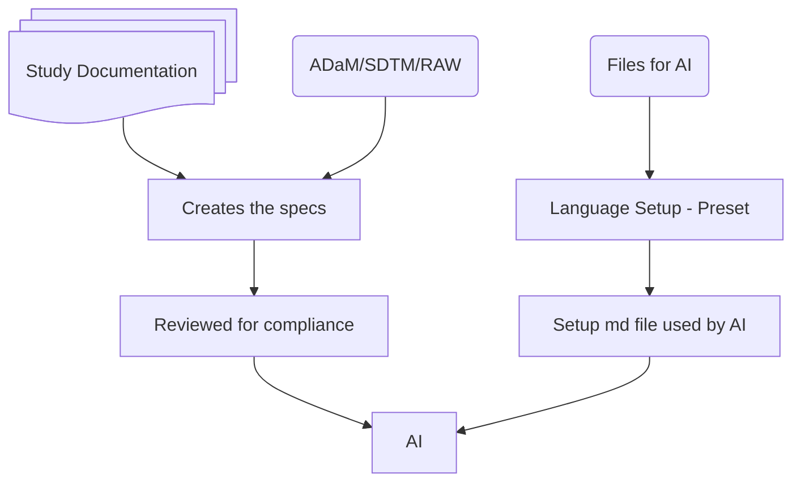

# Details
Here's more details on how it all fits together.

## Flow Chart
A more detailed look at how the proposed method will work.



## Language file
The Language file is nothing more than a setup file on how the "Setup md file used by AI" should be interpreted. 
- `OPEN` - Indicates the start of an instruction 
- `CLOSE` - Indicates the start of an instruction 
- `{}` - Document references that is part of the AI Chat
- `[]` - Indicates a data source:
   > - Values starting with `.` is a variables `[.AGE]`
   > - Values ending with `.` is a dataset `[ADSL.]`
   > - Values containing a `.` is a dataset and variable `[ADSL.AGE]`
- `@` - References to a particular document or data source
    ```
      e.g. Using the @<variable or data>
    ```
- `()` - Reserved for future use
- `<>` - Reserved for future use
- `/xxx/` - Short codes for instructions
- `#` - Reserved for future uses
- `:xxx:` - Is a definition description.

## Instruction File format
The propose format is as follow:    
Short names exists to reduce tokens and reduce typing.
             
|Long Name         |Short Name|Description                                       |
|---               |---       |---                                               |
|OPEN              |OPEN      |Start of the instruction                          |
|CLOSE             |CLOSE     |End of the instruction                            |
|Purpose           |/PU/      |Description of the instruction                    |
|Language Target   |/LN/      |SAS/R/Python                                      | 
|Rules + datatype  |/RD/      |Rules to be applied                               |
|When              |When      |What to do if certain scenarios wasn't met        |
|Out variable      |/OUT/     |The name of the output variable.                  |
|Constraint        |/CN/      |Any constraints that should be applied.           |
|Trace             |TRACE     |What variables should be used.                    |
|Verify            |/VR/      |When data issues are encountered, you'd place the details here.|
|Ambiguity         |/AB/      |Anything that needs human eyes list the details   |

Because the file consists of information that is already present in the specifications file, it leave it open for automation.

### Example of the instruction file

```
OPEN
  Purpose:
   To derive the age of a person
  
  Language Target:
   Write the code in SAS for me.

  Out Variable:
   agegr1

  Rules + datatype:
   agegr1 = [ADSL.AGE] between 2 and 12 is 1
   agegr1 = [ADSL.AGE] between 12 and 45 is 2

  When: 
  Missing AGE @/OUT/ is missing
    
  Constraint
  AGE > 2 and AGE <=80

  Trace:
  [ADSL.AGE]

  Verify
    AGE is > 0 and does not contain character values

  Ambiguity
   Missing AGE should be queried.
CLOSE   
```

## 