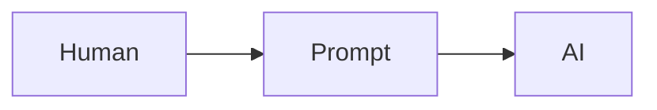
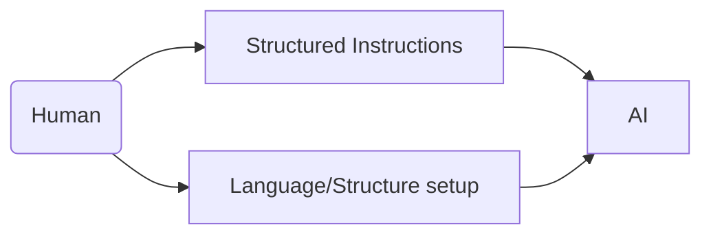

# Details (aiGL) 

Here's more details on how it all fits together.

## Flow Chart
A more detailed look at how the proposed method will work.

## Current order or work


## aiGL


## Language file
The Language file is nothing more than a setup file on how the "Setup md file used by AI" should be interpreted. 
- `OPEN` - Indicates the start of an instruction block
- `CLOSE` - Indicates the start of an instruction block
- `Final` - Indicates the end of the instructions in the file
- `{}` - Document references that is part of the AI Chat
- `[]` - Indicates a data source:
   > - Values starting with `.` is a variables `[.AGE]`
   > - Values ending with `.` is a dataset `[ADSL.]`
   > - Values containing a `.` is a dataset and variable `[ADSL.AGE]`
- `@` - References to a particular document or data source
    ```
      e.g. Using the @<variable or data>
    ```
- `()` - Reserved for future use
- `<>` - Reserved for future use
- `/xxx/` - Reserved for future use
- `#` - Reserved for future uses
- `D:` - Can only be present in the Input_Data section. It is used to define a Document that can be referenced in the specification.
- `:xxx:` - Is a definition description.

## Instruction File format
The propose format is as follow:    
Short names exists to reduce tokens and reduce typing.
             
|Long Name        |Description                                                |
|---              |---                                                        |
|OPEN <>          | Start of a specification block followed by the block name.|
|CLOSE <>         | End of a specification block followed by the block name.  |
|FINAL            | Post-processing instructions                              |
|PURPOSE          | Objective of the block                                    |
|LANGUAGE_TARGET  | Target Language. SAS, R, Python                           |
|Input_Data       | Input data                                                |
|Logic            | Execution rules                                           |
|Output           | Variable or output to be produced by the block            |
|Validation       | Validation rules                                          |
|Notes            | General instructions or notes for the block               |

Because the file consists of information that is already present in the specifications file, it leave it open for automation.

`Open <>: Close <>:` was selected to allow for better file viewing. When a file contains multiple instructions you can collapse the file to have a better view.

`output:` was selected over output_var to broaden the reach should the result needed not be a variable. This might change in the future.

### Extra notes on the language file
You can have only one FINAL entry.

### Example of the instruction file

```
OPEN AGE_GRP:
  Purpose:
   To derive the age of a person
  
  Language_Target:
   Write the code in SAS for me.

  Logic:
   agegr1 = [ADSL.AGE] between 2 and 12 is 1
   agegr1 = [ADSL.AGE] between 12 and 45 is 2

  Output:
   agegr1

  Validation:
    AGE is > 0 and does not contain character values

  Notes:
   Missing AGE should be queried.
CLOSE AGE_GRP:

Final:
Create a downloadable SAS program file
```

## 
