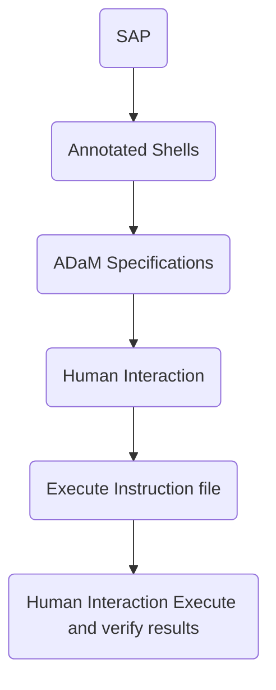

# QSE 
 
## Introduction
As AI is gaining tracktion, statistical programming in the Pharma Industry is evolving, and we need to evolve with it.

QSE - Quality Spec Execution is the first attempt to make AI and statistical programming aligned.

Keep in mind that this is V0.1.

## Still to come
[ ] A file parser is in development. 

## Licensing
GPL V3 applies - In short. You've received it free. You give it away from or pay.

## What is it
AI's work on prompts and most AI currently have a limit on the number of files that can be shared with it. Prompt's will be the new programming code for the future - a 6GL of sorts. The purpose behind QSE is to have a prompt generator that can be read by AI and that would be human readable at the same time.

Part of the constraints faced by programmers in the Pharma industry is specification. These have to be written in a very specific manner which is not sufficient for AI. As this is V0.1 the primary problem to address is prompts

## Prompt Format
The suggested format for a prompt is a aligning with markdown where as the language itself will be driven by a JSON file.

### The Language
As AI will be doing all the heavy lifting the language is nothing more than a JSON file.

#### Language Format file (JSON)
As it will involve a lot of typing the idea is to keep keyboard movements to the minimum and aviod any moues input.
- `{}` - Document references in the QSE file
- `[]` - Data source:
    > - Values starting with . is a variables `[.AGE]`
    > - Values ending with . is a dataset `[ADSL.]`
    > - Values with . is a dataset and variable `[ADSL.AGE]`
- `@` - References to a particular document or data source.
    ```
      Using the @<> 
    ```
- `()` - Reserved for future use
- `/xxx/` - Short codes for instructions
- `#` - Reserved for future uses
- `:`

### QSE File format
The propose format is as follow:                          
|Long Name         |Short Name|Description                           |
|---               |---       |---                                   |
|Purpose           |/PU/      |What is the purpose of the instruction|
|Language Target   |/LN/      |SAS/R/Python                          | 
|Rules + datatype  |/RD/      |Rules to be applied                   |
|When              |When      |What to do if certain scenarios wasn't met|
|Out variable      |/OUT/     |The name of the output variable.          |
|Constraint        |/CN/      |Any constraints that should be applied.   |
|Trace             |TRACE     |What variables should be used.            |
|Verify            |/VR/      |When data issues are encountered, you'd place the details here.|
|Ambiguity         |/AB/      |Anything that needs human eyes list the details here |

#### Here is an example of the file

```
  Purpose:
   To derive the age of a person
  
  Language Target:
   Write the code in SAS for me.

  Out Variable:
   agegr1

  Rules + datatype:
   agegr1 = [ADSL.AGE] between 2 and 12 is 1
   agegr1 = [ADSL.AGE] between 12 and 45 is 2

  When: 
  Missing AGE @/OUT/ is missing
    
  Constraint
  AGE > 2 and AGE <=80

  Trace:
  [ADSL.AGE]

  Verify
    AGE is > 0 and does not contain character values

  Ambiguity
   Missing AGE should be queried.
```

### Executing in AI
Run the following command in AI: 
Using qSpcExe_symbols.json executed the instruction in ADSL_age.md


#### Results
The results should generate but also importantly highlight the following:
Both rules include 12 as written.

I resolved that operationally by assigning 12 to group 1, because the first matching rule occurs first. That resolution is my implementation choice, not something specified by the source.

Also, the constraint permits ages through 80, while the supplied categorisation rules stop at 45, so ages >45 through 80 have no specified agegr1 assignment.

For qSpecExe testing, I'd therefore flag two specification queries: AGE = 12 boundary ownership, and AGE >45 through 80 classification.


## Flow chart
Flow chart based on ADaM specifications.


## AI Uploading 

### Mandatory
The following files are mandatory to be be uploaded:
- qSpcExe_symbols.json - This is the controller file.
- instruction file in md or text format.

### Recommended
The following files are strongly recommended to be be uploaded along with the mandatory ones:
- SAP or Protocol for SDTM
- Annotated shells or aCRF for SDTM
- Export of all datsets along with the Labels and variable names. SAS Proc Content