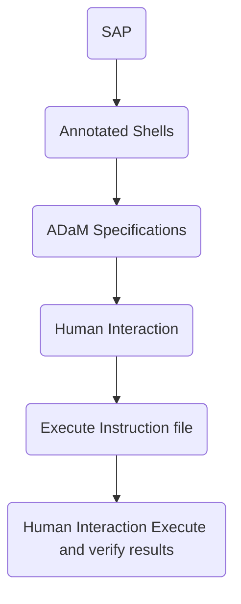

# aiGL - (ai Generation Language)
 
## Introduction
As AI is gaining tracktion, statistical programming in the Pharma Industry is evolving, and we need to evolve with it.

It started with the idea of Quality Spec Execution, but quickly evolved to aiGL. As this is a platform rather than a program.

Keep in mind that this is V0.1.

## ToDo
 - [ ] A file parser (in development)
 - [ ] Test cases 

## Licensing
Apache License 2.0 applies.

## What is it
AI's work on prompts and most AI currently have a limit on the number of files that can be shared with it. Prompt's will be the new programming code for the future, but prompt'scan be vague leadingto results that's incorrect. The purpose behind aiGL is to have a structure language that you define based on instructions you create that can be read by AI and that is more human friendly, and industry safe. Ambiguity and vagueness is not something not all industries embrace.

By nature spec tend to be vague.

Pharma industry specs suffers from the same. We tell what's be done not how, which is not what will be needed for AI. The SAP and ADRG supports this but leaves programmers clamoring through multiple files leading to a lose in productivity, and opening the door to vagueness and Ambiguity.

As this is V0.1 the primary problem to address is language setup and instructions.

### The Language
As AI will be doing all the heavy lifting the language is nothing more than a JSON file. The Language file is nothing more than a setup file on how the "Setup md file used by AI" should be interpreted. See details.

#### Naming convention
Any alpha numeric value.
No spacing in between
Substitute space with _

### aiGL File format
The file by design is very similar to a markdown file. It is based on a predefined structure to ensure that creation and reading is consistent. To ensure that the files supplied to AI is kept to a minimum you can have multiple instructions in one file. See details

### Executing in AI
Run the following command in AI: 
Using aiGL.json executed the instruction in ADSL_age.md

#### Results
The results should generate but also importantly highlight the following:
Both rules include 12 as written.

I resolved that operationally by assigning 12 to group 1, because the first matching rule occurs first. That resolution is my implementation choice, not something specified by the source.

Also, the constraint permits ages through 80, while the supplied categorisation rules stop at 45, so ages >45 through 80 have no specified agegr1 assignment.

For testing, I'd therefore flag two specification queries: AGE = 12 boundary ownership, and AGE >45 through 80 classification.

## Flow chart based on Pharma
Flow chart based on ADaM specifications.

## AI Uploading 

### Mandatory
The following files are mandatory to be be uploaded:
- qiGL.json - This is the language controller file.
- instruction file in md or text format.

### Recommended for Pharma
The following files are strongly recommended to be be uploaded along with the mandatory ones:
- SAP or Protocol for SDTM
- Annotated shells extract in JSON format or aCRF for SDTM
- Export of all datsets along with the Labels and variable names. SAS Proc Content
