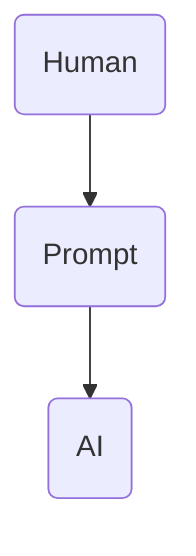
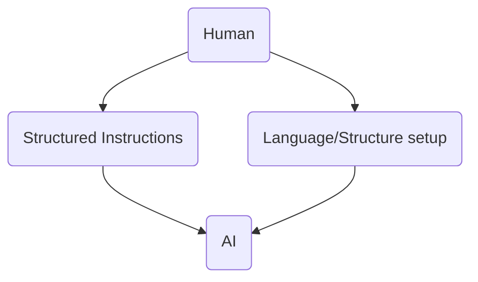

# aiGL

## Some details 
The way we communicate with AI is different. The way we program has changed forever.

Most people vibe code and that is fine for most instance but when dealing with critical data where you can't afford vagueness or ambiguity something more is needed, enter aiGL.

aiGL is more than a prompt. It's a language for people and AI a like. In short, you create your own language to fit your particular needs. You let AI excel with what it's good at.

We typically talk about Programming languages up to 4GL. However, we need something new to bridge the gap for the new era. Prompt's have been the back bone of Interaction thus far, but we need something more.

As programmers we need to face the fact that we'll not be able to match AI's capabilities in generating code as quick as it does, but we posses something critical - domain knowledge. Marrying the two is what's needed. This does not mean you don't need to know the programming language or topic you are planning to work with. You should have an understanding, the deeper the knowledge the better. 

aiGL simply taps into both sphere's to harness what both are good at enabling us to do more do it faster while striving for quality at the same time.

## Current setup

## aiGL

The Language/Structure setup is done only once.

## Very Important
A very important point: aiGL is Open Source.

## Back story for those interested
It started on early on 1OCT2026 when the idea was born on how we communicate with AI. I've "prompted" a lot of and realised I don't like prompts, I need more. The idea started as QSE but evolved rapidly to aiGL. As a concept it evolved faster and the more I worked the more it evolved.
